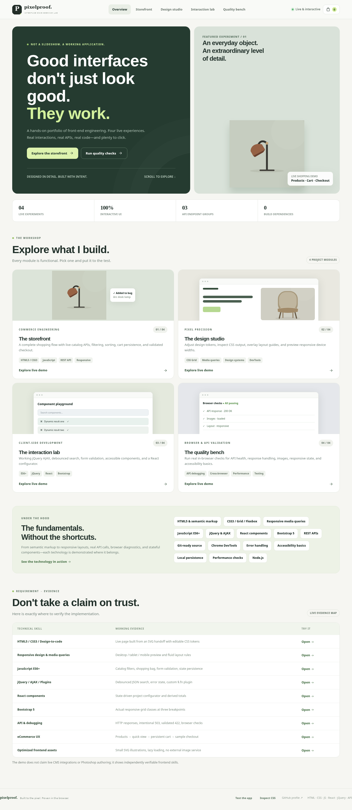
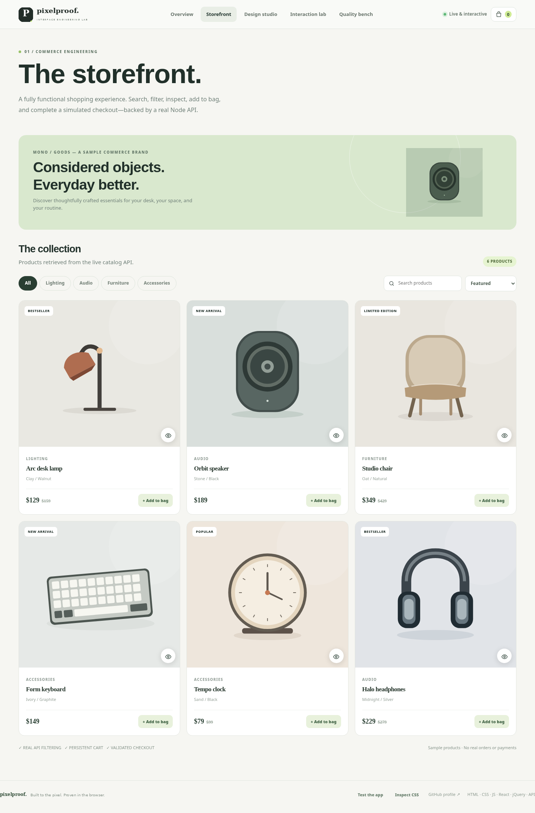
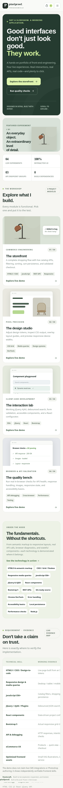

# PixelProof
### An interactive front-end engineering portfolio

**Built to the pixel. Proven in the browser.**

PixelProof is a responsive, interactive engineering showcase for a frontend developer role. It is not a collection of static screenshots or a slide deck: employers can use a working storefront, modify CSS on screen, interact with a real React component, exercise a jQuery API flow, and execute browser smoke checks.



> **Live URL:** Add your Render deployment URL here after publishing.
>
> **Source review:** See [Five-minute review guide](docs/REVIEW_GUIDE.md).

## Four interactive modules

| Module | What to try | Implementation evidence |
|---|---|---|
| **Storefront** | Search, filter, sort, product quick view, shopping bag, persistent quantities, sample checkout | `public/app.js`, `server.js`, `data.js` |
| **Design studio** | Responsive preview, adjustable design tokens, grid overlay, CSS export, design handoff SVG | `public/styles.css`, `public/assets/design-brief.svg` |
| **Interaction lab** | jQuery AJAX search with error states, custom plugin, React feature configurator, validation, Bootstrap grid | `public/jquery.characterBudget.js`, `public/react-lab.js` |
| **Quality bench** | Run six live checks against API, assets, responsive rules, semantics | `public/app.js`, `tests/server.test.js`, `.github/workflows/ci.yml` |



## Technologies demonstrated

**HTML5:** semantic landmarks, accessible form labels, native inputs, disclosure components.

**CSS3:** CSS Grid, Flexbox, variables, transitions, responsive media queries, reduced-motion support, custom control styling.

**JavaScript ES6+:** modern DOM APIs, arrow functions, template literals, async/await, Fetch, localStorage, debounced UI, error handling.

**jQuery:** real `$.ajax` calls to a Node API, event namespace management, and a reusable `$.fn.characterBudget` plugin.

**React:** actual stateful React component that computes totals using React state, isolated from jQuery-owned DOM.

**Bootstrap 5:** a real utility-based responsive grid in the Interaction Lab.

**Browser debugging:** real HTTP status codes (200, 422, 503), Chrome DevTools-compatible network paths, a user-triggered smoke test runner.

**Version control / automation:** repository-ready source layout, `.gitignore`, and a GitHub Actions workflow running syntax and API tests.

**eCommerce interface:** interactive product catalog, cart state, validation, no deceptive real-payment integration.

**Images:** original local SVG product illustrations, `loading="lazy"` where appropriate, explicit dimensions on product images.

## Architecture

```
Browser (HTML5 + CSS3 + ES6+ JavaScript + jQuery + React + Bootstrap)
              |
              | Fetch / $.ajax
              v
      Node.js HTTP server
              |
              +-- GET /api/health
              +-- GET /api/products?category=Audio&sort=price-asc&q=
              +-- GET /api/suggest?q=lamp
              +-- GET /api/suggest?q=lamp&simulate=error  [returns HTTP 503]
              +-- POST /api/orders                      [simulated]
              +-- Static assets + JS/CSS (locally served)
```

This app intentionally uses **zero third-party npm runtime dependencies**; React, jQuery, and Bootstrap assets are locally bundled. The React demonstration uses a small stateful component and the rest showcases native JS fundamentals. It is not intended to represent a production React/Vite project.

## Start locally

Requires **Node.js 20 or later**.

```bash
node server.js
```

Visit http://localhost:3000.

Run automated API tests and syntax verification:

```bash
npm test
npm run check
```

There is no `npm install` step and no API keys. Local data is sample-only. The `PORT` environment variable is respected for deployment.

## Deploy on Render

1. Create a **new public GitHub repository**, `PixelProof`, and upload the **contents of this folder** to the repository root. Make sure `server.js`, `package.json`, `public/`, `.github/`, and `render.yaml` are at the root.
2. In Render, select **New → Web Service**, and connect your new GitHub repository.
3. Configure **Runtime: Node**, **Build Command: `echo "no build required"`**, **Start Command: `node server.js`**, **Health Check Path: `/api/health`**, and the **Free** plan if available. Leave the root directory at repository root. Render sets `PORT` automatically.
4. Deploy. Once healthy, paste the Render URL into the **Live URL** field above and your GitHub repository description.

Alternatively, Render can read the included `render.yaml` as a Blueprint. Keep the repository contents at the root when using the Blueprint.

To publish with git from an extracted folder:

```bash
git init
git add .
git commit -m "Create interactive frontend engineering portfolio"
git branch -M main
git remote add origin https://github.com/sachintechpro/PixelProof.git
git push -u origin main
```

Create the empty repository on GitHub first. Do not add an extra auto-generated README there if you want the push to be straightforward.

## Important integrity notes

- Sample products and checkout are **demonstrations**. The server validates orders and calculates totals, but it **does not** charge cards, send emails, or persist orders. Sample order IDs are generated in memory.
- The design handoff reference is an **original SVG**, not a supplied Photoshop PSD. This project does not assert Photoshop, Illustrator, or Fireworks work experience.
- The in-browser checks do **not** prove testing in Firefox, Safari, or Edge. See the [manual QA plan](docs/MANUAL_QA.md) for an honest cross-browser test matrix.
- Preferred but unimplemented platforms (WordPress, Shopify, BigCommerce, Magento, PHP, MySQL) are intentionally not presented as integrated systems.
- AI-assisted coding may accelerate development; review and validation of generated work remain necessary. This repository includes testable code rather than claims of AI proficiency.

## Screenshots

| Desktop | Mobile |
|---|---|
|  |  |

## License

MIT. The local third-party frontend bundles retain their upstream licensing; see vendor versions below. Original SVG illustrations are created for this project.

**Locally bundled libraries:** jQuery 3.6.x, React 16.0.x, ReactDOM 16.0.x, Bootstrap CSS 5.1.1. All are under their respective MIT licenses. For a new production application, update these dependencies to their currently supported stable versions and use a modern bundler.

## Featuring PixelProof on your profile

After uploading and deploying, see [GitHub profile instructions](docs/GITHUB_PROFILE.md) to pin the project and add the live URL to your profile README.
